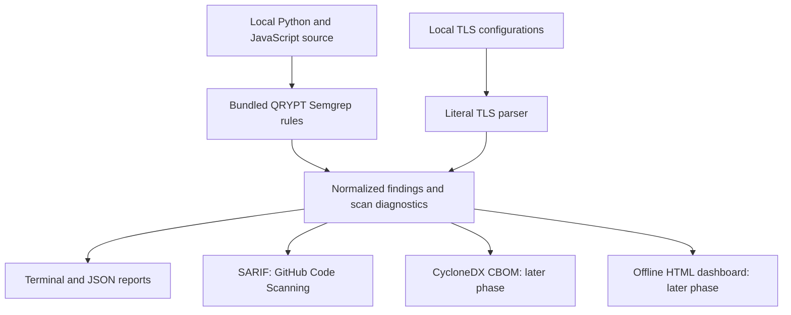

# QRYPT — PQC Security Scanner

A developer-first scanner for post-quantum cryptography (PQC) migration readiness. QRYPT identifies supported cryptographic API usage in Python and Node.js source code and produces migration-candidate reports. SARIF exports support GitHub Code Scanning; local Nginx and OpenSSL declarations are also supported.

The project demonstrates cryptographic inventory, AppSec analysis, security automation, and DevSecOps integration. Its intended users are developers and security engineers reviewing cryptographic dependencies before migration.

> **Status: Phase 3 implemented locally.** Source scanning, terminal/JSON/SARIF reports, GitHub Actions, and Docker are available, with local TLS analysis for the v0.2 milestone. GitHub workflow execution and the public Code Scanning demo remain pending; the current repository is private. CBOM and the dashboard are planned. This is an early development version, not a comprehensive cryptographic audit.

## Purpose

Cryptographic discovery and inventory are central to [NIST's PQC migration guidance](https://pages.nist.gov/nccoe-migration-post-quantum-cryptography/). QRYPT will make that review practical for a source repository: locate supported cryptographic API usage, preserve evidence, and suggest what to investigate next.

Findings are **migration candidates requiring verification**, not proof of an exploitable vulnerability. A rule match cannot determine business impact, data-retention requirements, or whether the code runs in production. Zero findings will not establish PQC readiness.

## Capabilities

Available now:

- A local Python CLI backed by QRYPT-authored Semgrep Community Edition rules.
- Python `cryptography` and PyCryptodome coverage, plus JavaScript coverage for Node.js `crypto`.
- Detection of explicit RSA, DH, and elliptic-curve operations, distinguishing key agreement, signing, and key generation when evidence permits.
- Terminal, versioned JSON, and schema-validated SARIF 2.1.0 reports with scan diagnostics and file counts.
- Advisory CI behavior, with an explicit option to fail on findings.
- GitHub Actions for tests, packaging, container smoke checks, and SARIF artifacts; completed scans upload on public repositories.
- Literal Nginx/OpenSSL TLS group, signature and cipher configuration analysis, with unresolved-input diagnostics.
- An interactive terminal banner that leaves machine-readable output untouched.
- A non-root Docker image with a pinned base digest and dependency versions.

Later releases will add CycloneDX cryptographic inventory and an offline HTML dashboard. Browser Web Crypto, TypeScript, and other libraries are outside the initial coverage.

## Architecture



Semgrep handles syntax-aware matching; QRYPT adds cryptographic interpretation and reporting. Each finding includes a stable rule ID, relative file location, algorithm evidence, operation where identifiable, confidence, and migration-review guidance. Confidence describes the matched API evidence, not exploitability or business risk.

Implementation uses Python 3.12+, `argparse`, setuptools, and Semgrep CE 1.177.0. Source and bundled rules live under `src/qrypt/`; tests and annotated rule fixtures live under `tests/`. The `examples/` directory contains scan inputs. Terminal, JSON, and SARIF reports share one finding model.

## Installation and Usage

Requires Python 3.12+ with working `venv` and pip support, and a platform supported by Semgrep CE. On Debian/Ubuntu, install the matching Python `venv` package if environment creation reports missing `ensurepip`.

```bash
python3 -m venv .venv
source .venv/bin/activate
python -m pip install -e .
qrypt scan examples
```

The example directory produces 25 migration candidates across four files. Scanning does not import or execute them, so their application dependencies are not required. `python -m qrypt` is also supported.

```bash
# Review supported source and configuration files in the current repository
qrypt scan .

# Write a machine-readable migration report
qrypt scan ./examples --format json --output report.json

# Export repository-relative findings for GitHub Code Scanning
qrypt scan . --format sarif --output qrypt.sarif

# Explicitly enforce findings in CI
qrypt scan . --fail-on-findings
```

Terminal output is the default; completed interactive text scans show the QRYPT banner. Redirected output and report files have no banner. `--format json` produces JSON with `schema_version: 1`, completion status, file counts, findings, and errors. Reports go to standard output unless `--output` is supplied; diagnostics go to standard error.

Output files must use `.json` for JSON, `.sarif` for SARIF, or `.txt` for terminal reports. Their parent directory must exist, and symlink destinations are rejected. Python, JavaScript, and Markdown files cannot be used as report destinations. An existing report destination is replaced atomically. Later phases will add `cbom` and `html` formats.

Scans support `.py`, `.js`, `.mjs`, `.cjs`, `.conf`, and `.cnf`, honor Git/Semgrep ignore rules, and exclude `.git`, virtual environments, `node_modules`, `vendor`, `build`, and `dist`. Analysis failures and source files skipped because of limits (including Semgrep's default size limit) produce relative-path diagnostics and exit code `2`; intentional ignore/exclusion decisions do not. A target with no scannable files also returns `2`. The Semgrep process has a 120-second time limit. QRYPT prefers the Semgrep executable installed alongside its interpreter, with a PATH fallback.

| Exit code | Meaning |
| --- | --- |
| `0` | Scan completed; findings are advisory by default. |
| `1` | Findings were detected and `--fail-on-findings` was enabled. |
| `2` | Invalid input, scanner failure, output failure, or an incomplete scan. |

## SARIF and GitHub Actions

SARIF results use warning level, stable rule IDs, migration-review guidance, URI-escaped relative paths, line locations, and API-evidence confidence. They carry no source snippets or numeric vulnerability scores. Incomplete scans retain partial findings and set `invocations[].executionSuccessful` to `false`; exit code `2` still takes precedence.

SARIF uses line-only regions because Semgrep column offsets count bytes; exporting them as Unicode columns would misplace highlights. The source base has a description without an absolute URI to preserve privacy; map `%SRCROOT%` to your local scan directory in viewers that require it.

Paths are relative to the **scan target directory** (or the parent of a single-file target). For GitHub uploads, scan `.` from the repository root so locations identify committed files. Keep the same scan root between runs. The official `upload-sarif` action generates missing fingerprints from checked-out source; direct API uploads do not offer this deduplication assistance.

[`.github/workflows/ci.yml`](.github/workflows/ci.yml) runs on pushes, pull requests, and manual dispatches. It tests Python 3.12/3.14, builds and installs the wheel, and scans a read-only checkout in Docker. Scans are advisory; scanner errors fail the job. Reports are retained as artifacts, including incomplete reports, but only completed scans are uploaded. Actions are pinned to commit SHAs and the scan job alone receives `security-events: write`.

Code Scanning upload is enabled only for public repositories. The current private personal repository retains SARIF artifacts; a public demo and hosted workflow verification remain pending. Publishing or changing visibility is a separate step. See [GitHub's upload instructions](https://docs.github.com/en/code-security/how-tos/find-and-fix-code-vulnerabilities/integrate-with-existing-tools/upload-sarif-file).

Example reports generated with `qrypt scan .` are in [`examples/reports/`](examples/reports/): 25 candidates from the two source and two TLS example files. Scan counts also include supported scanner source files.

## Docker

```bash
docker build -t qrypt:0.2 .
docker run --rm --network none --read-only \
  --tmpfs /tmp:rw,noexec,nosuid,size=256m \
  -v "$PWD:/workspace:ro" qrypt:0.2 scan . --format sarif > qrypt.sarif
```

The image uses Python 3.12 on Debian Bookworm, installs QRYPT outside the mounted checkout, and runs as UID/GID 65532. Mounted source must be readable by that user. Keep reports on the host through stdout; the checkout stays read-only. Installation needs network access, scanning does not.

The base digest and all runtime/build dependency versions are pinned in `Dockerfile` and `requirements-container.txt`. Builds use wheels and disable dependency resolution/build isolation for the local package. This fixes dependency selection, not byte-identical image timestamps. Linux amd64 is verified; other architectures are not yet verified. When refreshing dependencies, resolve them in the pinned Python 3.12 base, update the complete lock, and repeat tests plus container exit-code checks.

## Implementation Roadmap

Each phase must meet its completion criteria before the next begins. Release labels are milestones, not delivery-date commitments.

| Phase | Deliverables | Completion criteria |
| --- | --- | --- |
| **0 — Design and documentation · complete** | Define scope, architecture, planned interfaces, limitations, and this roadmap. | Review documentation and links; distinguish planned features from working features. |
| **1 — Source scanner · complete** | Package the CLI; add Python and Node.js rules, terminal output, and JSON reports. | Installed CLI scans example projects; every rule has positive and negative fixtures; unrelated strings and comments do not trigger findings. |
| **2 — SARIF and CI · v0.1 · local implementation complete** | Add SARIF, GitHub Actions, documented rule coverage, example reports, and a reproducible Docker image. | Validate SARIF; demonstrate alerts in a public repository; verify package installation, container execution, and exit codes. **First public release.** |
| **3 — TLS configurations · v0.2 · complete locally** | Scan explicit Nginx and OpenSSL declarations for groups, signature algorithms, and relevant cipher settings. | Test declarations, comments, exclusions, and unresolved settings; distinguish configured intent from negotiated behavior. |
| **4 — Cryptographic inventory · v0.3** | Export CycloneDX 1.6 CBOM for observed algorithms and supported occurrence evidence; recognize supported explicit ML-KEM/ML-DSA identifiers as inventory entries. | Validate against the CycloneDX schema; retain occurrence locations; do not invent dependency relationships or treat PQC identifiers as migration warnings. |
| **5 — Dashboard and portfolio · v0.4** | Generate a self-contained HTML report with algorithm, rule, and file filters; add a demo GIF and measured scan results. | Report opens without a server or external assets, safely escapes content, and matches JSON findings; publish the demo, threat model, and evaluation methodology. |

## Detection Coverage

Ten original rules cover these explicit API calls:

| Library | Supported calls |
| --- | --- |
| Python `cryptography` | `rsa.generate_private_key`, `dh.generate_parameters`, `ec.generate_private_key`, `ec.ECDH`, `ec.ECDSA` |
| PyCryptodome, including the `Cryptodome` namespace | `RSA.generate`, `ECC.generate` |
| Node.js `crypto` / `node:crypto` | `generateKeyPair` / `generateKeyPairSync` with `rsa`, `rsa-pss`, `ec`, or `dh`; `createECDH`; `createDiffieHellman`; `getDiffieHellman`; `createDiffieHellmanGroup` |

Fixtures exercise Python aliases and Node.js CommonJS `const` bindings and ES-module namespace/default/named imports, including aliases. Ordinary parameter and local-variable shadowing, unrelated functions, comments, and strings have negative controls.

Generic EC key generation is reported as **EC**, not inferred to be ECDSA or ECDH. Imports alone, key loading, arbitrary signing/encryption calls, indirect wrappers, and other cryptographic libraries are not inventoried. Python syntax is checked using the scanner's interpreter; JavaScript parsing relies on Semgrep diagnostics and may recover fragments without reporting every syntax error.

## Local TLS Configuration Coverage

```bash
qrypt scan examples/nginx.conf
qrypt scan examples/openssl.cnf --format sarif --output tls.sarif
```

`.cnf`, filenames starting with `openssl`, and `*.openssl.conf` use OpenSSL assignment syntax. Other `.conf` files use Nginx directive syntax. Ignore unrelated configuration formats using `.semgrepignore`. Both parsers support comments, quoted values, and multiline declarations (backslash continuation for OpenSSL).

| Nginx declaration | OpenSSL command | Evidence |
| --- | --- | --- |
| `ssl_ecdh_curve`, `ssl_conf_command Groups/Curves` | `Groups`, `Curves` | X25519/X448 as ECDH; P-256/P-384/P-521 and corresponding named curves as EC; named `ffdhe` groups as DH |
| `ssl_conf_command SignatureAlgorithms/ClientSignatureAlgorithms` | Same commands | Explicit RSA, ECDSA, DSA+hash and Ed25519/Ed448 signature declarations |
| `ssl_ciphers`, `ssl_conf_command CipherString` | `CipherString` | Explicit ECDHE/DHE cipher families with RSA/ECDSA authentication; supported RSA/DH/ECDH/ECDSA selectors |
| `ssl_conf_command Ciphersuites` | `Ciphersuites` | Recognizes standard TLS 1.3 symmetric suites without inferring key exchange or authentication |
| `ssl_dhparam`, `ssl_conf_command DHParameters` | `DHParameters` | DH parameter-file references; files are not read |

Four TLS report rules supplement the ten source rules. Findings describe **literal configured intent**, including declarations in inactive OpenSSL sections; they do not determine activation, inheritance, overrides, provider support, certificates or negotiated sessions. Group declarations use EC when key agreement versus signing cannot be inferred.

Cipher `!` exclusions are permanent within a declaration; `-` removes earlier entries but permits re-addition; leading `+` only reorders existing entries. Authentication and key-exchange selectors remain distinct (`aRSA` versus `kRSA`). This is a bounded selector interpreter, not OpenSSL's full cipher expansion: unknown selectors, intersections, defaults such as `HIGH`/`DEFAULT`/`auto`, variables and unsupported algorithm names yield `TLSUnresolvedSetting` and exit `2`. Partial literal findings are retained.

Includes are never followed and produce `TLSUnresolvedInclude`, even when they may be unrelated to TLS. Invalid supported syntax, unreadable files and encoding failures also make the scan incomplete. Diagnostics omit configuration values and referenced paths. Missing settings, certificates and inherited defaults remain outside coverage; zero findings is not a deployment assessment. Use native configuration validators separately before deployment.

## Testing and Evaluation

Install development tools and run the checks:

```bash
python -m pip install -e ".[dev]"
python -m pytest
ruff check .
ruff format --check .
python -m build
```

Build artifacts are written to the ignored `dist/` directory. Tests use the Semgrep executable installed alongside the active Python interpreter. Fixtures and scan examples are deliberately excluded from Ruff formatting so their annotated locations and input shapes remain stable.

The suite uses pytest for CLI/report integration and real Semgrep scans of annotated rule fixtures. It also covers incomplete Python scans, exclusions, report privacy, unsafe output paths, atomic-write failures, timeouts, missing engines, and exit codes. SARIF validation runs offline against the vendored OASIS schema in `tests/schemas/`; CBOM validation is planned.

Test import aliases, multiline calls, unrelated identifiers, symmetric/hash controls, malformed files, excluded directories, missing scanner dependencies, output failures, and each exit code. TLS tests cover negated cipher entries, variables/defaults/includes, multiline values, mixed targets, schema-valid SARIF, read/encoding failures, and oversized inputs. Banner tests cover TTY and output-mode boundaries.

Measure precision, recall, and scan time against a labeled example corpus. Publish the corpus size, coverage boundaries, tool versions, and execution environment with the results. Do not claim a coverage threshold or performance result before measuring it.

## Threat Model and Limitations

- **Untrusted inputs:** inspect repository files without executing application code, installing target dependencies, or loading repository-supplied rules.
- **Local operation:** bundle original rules and disable Semgrep metrics and version checks. Scanning should require no account or network connection after installation.
- **Report privacy:** omit source snippets and key material. File paths and algorithm metadata may still disclose project details; review reports before publishing.
- **Static-analysis limits:** dynamic algorithm selection, wrappers, unsupported APIs, and cross-file behavior may be missed. Surface scan failures and skipped coverage rather than reporting a clean assessment.
- **TLS evidence:** literal configuration matches will not resolve every include, inherited default, or deployment setting. Cipher suites alone do not establish PQC readiness; key exchange and authentication require separate review.
- **Migration guidance:** recommendations will reflect cryptographic purpose and compatibility requirements. QRYPT will not automatically replace cryptography or assign an unsupported readiness score.

Live TLS probing, hosted services, authentication, baseline management, and automatic remediation are deferred.

## References

- [NIST: Migration to Post-Quantum Cryptography](https://pages.nist.gov/nccoe-migration-post-quantum-cryptography/)
- [Semgrep Community Edition](https://semgrep.dev/products/community-edition/)
- [Semgrep CLI reference](https://docs.semgrep.dev/cli-reference)
- [GitHub: SARIF support for code scanning](https://docs.github.com/en/code-security/reference/code-scanning/sarif-files/sarif-support)
- [CycloneDX: Cryptography Bill of Materials](https://cyclonedx.org/capabilities/cbom/)
- [Nginx: SSL module](https://nginx.org/en/docs/http/ngx_http_ssl_module.html)
- [OpenSSL: TLS configuration commands](https://docs.openssl.org/3.0/man3/SSL_CONF_cmd/)
