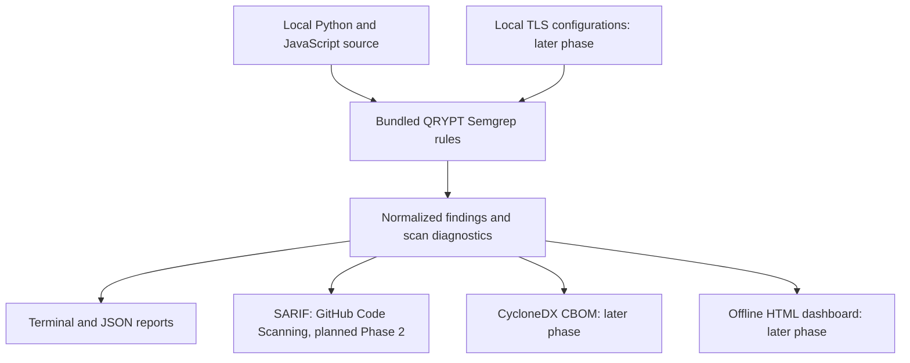

# QRYPT — PQC Security Scanner

A developer-first scanner for post-quantum cryptography (PQC) migration readiness. QRYPT identifies supported cryptographic API usage in Python and Node.js source code and produces migration-candidate reports. Local TLS configuration analysis and GitHub Code Scanning exports are planned extensions.

The project demonstrates cryptographic inventory, AppSec analysis, security automation, and DevSecOps integration. Its intended users are developers and security engineers reviewing cryptographic dependencies before migration.

> **Status: Phase 1 implemented.** The local source scanner, terminal reports, and JSON reports are available. SARIF, GitHub Actions, Docker, TLS analysis, CBOM, and the dashboard remain planned. This is an early development version, not a comprehensive cryptographic audit.

## Purpose

Cryptographic discovery and inventory are central to [NIST's PQC migration guidance](https://pages.nist.gov/nccoe-migration-post-quantum-cryptography/). QRYPT will make that review practical for a source repository: locate supported cryptographic API usage, preserve evidence, and suggest what to investigate next.

Findings are **migration candidates requiring verification**, not proof of an exploitable vulnerability. A rule match cannot determine business impact, data-retention requirements, or whether the code runs in production. Zero findings will not establish PQC readiness.

## Capabilities

Available in Phase 1:

- A local Python CLI backed by QRYPT-authored Semgrep Community Edition rules.
- Python `cryptography` and PyCryptodome coverage, plus JavaScript coverage for Node.js `crypto`.
- Detection of explicit RSA, DH, and elliptic-curve operations, distinguishing key agreement, signing, and key generation when evidence permits.
- Terminal and versioned JSON migration reports with scan diagnostics and file counts.
- Advisory CI behavior, with an explicit option to fail on findings.

Phase 2 will add SARIF 2.1.0 and GitHub Actions for the first public release. Later releases will add Nginx and OpenSSL configuration analysis, CycloneDX cryptographic inventory, and an offline HTML dashboard. Browser Web Crypto, TypeScript, and other libraries are outside the initial coverage.

## Architecture



Semgrep handles syntax-aware matching; QRYPT adds cryptographic interpretation and reporting. Each finding includes a stable rule ID, relative file location, algorithm evidence, operation where identifiable, confidence, and migration-review guidance. Confidence describes the matched API evidence, not exploitability or business risk.

Implementation uses Python 3.12+, `argparse`, setuptools, and Semgrep CE 1.177.0. Source and bundled rules live under `src/qrypt/`; tests and annotated rule fixtures live under `tests/`. The `examples/` directory contains scan inputs. Terminal and JSON reports share one finding model.

## Installation and Usage

Requires Python 3.12+ with working `venv` and pip support, and a platform supported by Semgrep CE. On Debian/Ubuntu, install the matching Python `venv` package if environment creation reports missing `ensurepip`.

```bash
python3 -m venv .venv
source .venv/bin/activate
python -m pip install -e .
qrypt scan examples
```

The example directory produces ten migration candidates across two files. Scanning does not import or execute them, so their application dependencies are not required. `python -m qrypt` is also supported.

```bash
# Review supported source files in the current repository
qrypt scan .

# Write a machine-readable migration report
qrypt scan ./examples --format json --output report.json

# Explicitly enforce findings in CI
qrypt scan . --fail-on-findings
```

Terminal output is the default; `--format json` produces JSON with `schema_version: 1`, completion status, file counts, findings, and errors. Reports go to standard output unless `--output` is supplied; diagnostics go to standard error.

Output files must use `.json` for JSON or `.txt` for terminal reports. Their parent directory must exist, and symlink destinations are rejected. Python, JavaScript, and Markdown files cannot be used as report destinations. An existing `.json` or `.txt` destination is replaced atomically. Later phases will add `sarif`, `cbom`, and `html` formats.

Scans support `.py`, `.js`, `.mjs`, and `.cjs`, honor Git/Semgrep ignore rules, and exclude `.git`, virtual environments, `node_modules`, `vendor`, `build`, and `dist`. Analysis failures and source files skipped because of limits (including Semgrep's default size limit) produce relative-path diagnostics and exit code `2`; intentional ignore/exclusion decisions do not. A target with no scannable files also returns `2`. Scans have a 120-second total time limit. QRYPT prefers the Semgrep executable installed alongside its interpreter, with a PATH fallback.

| Exit code | Meaning |
| --- | --- |
| `0` | Scan completed; findings are advisory by default. |
| `1` | Findings were detected and `--fail-on-findings` was enabled. |
| `2` | Invalid input, scanner failure, output failure, or an incomplete scan. |

## Implementation Roadmap

Each phase must meet its completion criteria before the next begins. Release labels are milestones, not delivery-date commitments.

| Phase | Deliverables | Completion criteria |
| --- | --- | --- |
| **0 — Design and documentation · complete** | Define scope, architecture, planned interfaces, limitations, and this roadmap. | Review documentation and links; distinguish planned features from working features. |
| **1 — Source scanner · complete** | Package the CLI; add Python and Node.js rules, terminal output, and JSON reports. | Installed CLI scans example projects; every rule has positive and negative fixtures; unrelated strings and comments do not trigger findings. |
| **2 — SARIF and CI · v0.1** | Add SARIF, GitHub Actions, documented rule coverage, example reports, and a reproducible Docker image. | Validate SARIF; demonstrate alerts in a public repository; verify package installation, container execution, and exit codes. **First public release.** |
| **3 — TLS configurations · v0.2** | Scan explicit Nginx and OpenSSL declarations for groups, signature algorithms, and relevant cipher settings. | Test declarations, comments, exclusions, and unresolved settings; distinguish configured intent from negotiated behavior. |
| **4 — Cryptographic inventory · v0.3** | Export CycloneDX 1.6 CBOM for observed algorithms and supported occurrence evidence; recognize supported explicit ML-KEM/ML-DSA identifiers as inventory entries. | Validate against the CycloneDX schema; retain occurrence locations; do not invent dependency relationships or treat PQC identifiers as migration warnings. |
| **5 — Dashboard and portfolio · v0.4** | Generate a self-contained HTML report with algorithm, rule, and file filters; add a demo GIF and measured scan results. | Report opens without a server or external assets, safely escapes content, and matches JSON findings; publish the demo, threat model, and evaluation methodology. |

## Detection Coverage

Ten original rules cover these explicit API calls:

| Library | Supported calls |
| --- | --- |
| Python `cryptography` | `rsa.generate_private_key`, `dh.generate_parameters`, `ec.generate_private_key`, `ec.ECDH`, `ec.ECDSA` |
| PyCryptodome, including the `Cryptodome` namespace | `RSA.generate`, `ECC.generate` |
| Node.js `crypto` / `node:crypto` | `generateKeyPair` / `generateKeyPairSync` with `rsa`, `rsa-pss`, `ec`, or `dh`; `createECDH`; `createDiffieHellman`; `getDiffieHellman`; `createDiffieHellmanGroup` |

Fixtures exercise Python aliases and Node.js CommonJS `const` bindings and ES-module namespace/default/named imports, including aliases. Ordinary parameter and local-variable shadowing, unrelated functions, comments, and strings have negative controls.

Generic EC key generation is reported as **EC**, not inferred to be ECDSA or ECDH. Imports alone, key loading, arbitrary signing/encryption calls, indirect wrappers, and other cryptographic libraries are not inventoried. Python syntax is checked using the scanner's interpreter; JavaScript parsing relies on Semgrep diagnostics and may recover fragments without reporting every syntax error.

## Testing and Evaluation

Install development tools and run the checks:

```bash
python -m pip install -e ".[dev]"
python -m pytest
ruff check .
ruff format --check .
python -m build
```

Build artifacts are written to the ignored `dist/` directory. Tests use the Semgrep executable installed alongside the active Python interpreter. Fixtures and scan examples are deliberately excluded from Ruff formatting so their annotated locations and input shapes remain stable.

The suite uses pytest for CLI/report integration and real Semgrep scans of annotated rule fixtures. It also covers incomplete Python scans, exclusions, report privacy, unsafe output paths, atomic-write failures, timeouts, missing engines, and exit codes. SARIF and CBOM schema validation will arrive with their respective phases.

Test import aliases, multiline calls, unrelated identifiers, symmetric/hash controls, malformed files, excluded directories, missing scanner dependencies, output failures, and each exit code. TLS tests must cover negated cipher entries and unresolved variables or defaults.

Measure precision, recall, and scan time against a labeled example corpus. Publish the corpus size, coverage boundaries, tool versions, and execution environment with the results. Do not claim a coverage threshold or performance result before measuring it.

## Threat Model and Limitations

- **Untrusted inputs:** inspect repository files without executing application code, installing target dependencies, or loading repository-supplied rules.
- **Local operation:** bundle original rules and disable Semgrep metrics and version checks. Scanning should require no account or network connection after installation.
- **Report privacy:** omit source snippets and key material. File paths and algorithm metadata may still disclose project details; review reports before publishing.
- **Static-analysis limits:** dynamic algorithm selection, wrappers, unsupported APIs, and cross-file behavior may be missed. Surface scan failures and skipped coverage rather than reporting a clean assessment.
- **TLS evidence:** literal configuration matches will not resolve every include, inherited default, or deployment setting. Cipher suites alone do not establish PQC readiness; key exchange and authentication require separate review.
- **Migration guidance:** recommendations will reflect cryptographic purpose and compatibility requirements. QRYPT will not automatically replace cryptography or assign an unsupported readiness score.

Live TLS probing, hosted services, authentication, baseline management, and automatic remediation are deferred.

## References

- [NIST: Migration to Post-Quantum Cryptography](https://pages.nist.gov/nccoe-migration-post-quantum-cryptography/)
- [Semgrep Community Edition](https://semgrep.dev/products/community-edition/)
- [Semgrep CLI reference](https://docs.semgrep.dev/cli-reference)
- [GitHub: SARIF support for code scanning](https://docs.github.com/en/code-security/reference/code-scanning/sarif-files/sarif-support)
- [CycloneDX: Cryptography Bill of Materials](https://cyclonedx.org/capabilities/cbom/)
- [Nginx: SSL module](https://nginx.org/en/docs/http/ngx_http_ssl_module.html)
- [OpenSSL: TLS configuration commands](https://docs.openssl.org/3.0/man3/SSL_CONF_cmd/)
