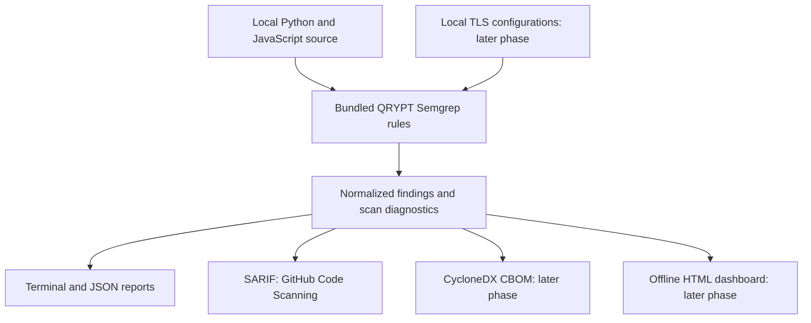

# QRYPT — PQC Security Scanner

A developer-first scanner for post-quantum cryptography (PQC) migration readiness. QRYPT will identify potentially quantum-vulnerable cryptographic usage in source code and local TLS configurations, explain migration considerations, and export findings for GitHub Code Scanning.

The project demonstrates cryptographic inventory, AppSec analysis, security automation, and DevSecOps integration. Its intended users are developers and security engineers reviewing cryptographic dependencies before migration.

> **Status: planning stage.** No scanner, package, container, or dashboard exists yet. All capabilities, commands, and releases below are planned.

## Purpose

Cryptographic discovery and inventory are central to [NIST's PQC migration guidance](https://pages.nist.gov/nccoe-migration-post-quantum-cryptography/). QRYPT will make that review practical for a source repository: locate supported cryptographic API usage, preserve evidence, and suggest what to investigate next.

Findings are **migration candidates requiring verification**, not proof of an exploitable vulnerability. A rule match cannot determine business impact, data-retention requirements, or whether the code runs in production. Zero findings will not establish PQC readiness.

## Planned Capabilities

The first public release will provide:

- A local Python CLI backed by QRYPT-authored Semgrep Community Edition rules.
- Python `cryptography` and PyCryptodome coverage, plus JavaScript coverage for Node.js `crypto`.
- Detection of explicit RSA, DH, and elliptic-curve operations, distinguishing key agreement, signing, and key generation when evidence permits.
- Terminal and versioned JSON migration reports, plus SARIF 2.1.0 for GitHub Code Scanning.
- Advisory CI behavior, with an explicit option to fail on findings.

Later releases will add Nginx and OpenSSL configuration analysis, CycloneDX cryptographic inventory, and an offline HTML dashboard. Browser Web Crypto, TypeScript, and other libraries are outside the initial coverage.

## Planned Architecture



Semgrep will handle syntax-aware matching; QRYPT will add cryptographic interpretation and reporting. Each finding will include a stable rule ID, relative file location, algorithm evidence, operation where identifiable, confidence, and migration-review guidance.

Implementation will use Python 3.12+, `argparse`, setuptools, and Semgrep CE. Source and bundled rules will live under `src/qrypt/`; tests and rule fixtures will live under `tests/`. Reports will share one finding model rather than separate detection logic.

## Planned Usage

These examples define the intended CLI interface; they do not work yet. Installation instructions will be added once packaging is implemented and verified.

```bash
# Review supported source files in the current repository
qrypt scan .

# Write a machine-readable migration report
qrypt scan ./examples --format json --output report.json

# Export findings for GitHub Code Scanning
qrypt scan . --format sarif --output qrypt.sarif

# Explicitly enforce findings in CI
qrypt scan . --fail-on-findings
```

Terminal output will be the default. JSON and SARIF will go to standard output unless `--output` is supplied; diagnostics will go to standard error. Later phases will add `cbom` and `html` formats.

| Exit code | Meaning |
| --- | --- |
| `0` | Scan completed; findings are advisory by default. |
| `1` | Findings were detected and `--fail-on-findings` was enabled. |
| `2` | Invalid input, scanner failure, output failure, or an incomplete scan. |

## Implementation Roadmap

Each phase must meet its completion criteria before the next begins. Release labels are milestones, not delivery-date commitments.

| Phase | Deliverables | Completion criteria |
| --- | --- | --- |
| **0 — Design and documentation** | Define scope, architecture, planned interfaces, limitations, and this roadmap. | Review documentation and links; distinguish planned features from working features. |
| **1 — Source scanner** | Package the CLI; add Python and Node.js rules, terminal output, and JSON reports. | Installed CLI scans example projects; every rule has positive and negative fixtures; unrelated strings and comments do not trigger findings. |
| **2 — SARIF and CI · v0.1** | Add SARIF, GitHub Actions, documented rule coverage, example reports, and a reproducible Docker image. | Validate SARIF; demonstrate alerts in a public repository; verify package installation, container execution, and exit codes. **First public release.** |
| **3 — TLS configurations · v0.2** | Scan explicit Nginx and OpenSSL declarations for groups, signature algorithms, and relevant cipher settings. | Test declarations, comments, exclusions, and unresolved settings; distinguish configured intent from negotiated behavior. |
| **4 — Cryptographic inventory · v0.3** | Export CycloneDX 1.6 CBOM for observed algorithms and supported occurrence evidence; recognize supported explicit ML-KEM/ML-DSA identifiers as inventory entries. | Validate against the CycloneDX schema; retain occurrence locations; do not invent dependency relationships or treat PQC identifiers as migration warnings. |
| **5 — Dashboard and portfolio · v0.4** | Generate a self-contained HTML report with algorithm, rule, and file filters; add a demo GIF and measured scan results. | Report opens without a server or external assets, safely escapes content, and matches JSON findings; publish the demo, threat model, and evaluation methodology. |

## Planned Testing and Evaluation

Use pytest for CLI and report integration, Semgrep rule fixtures for detection, and Ruff for Python checks. Validate exported SARIF and CBOM against their respective schemas.

Test import aliases, multiline calls, unrelated identifiers, symmetric/hash controls, malformed files, excluded directories, missing scanner dependencies, output failures, and each exit code. TLS tests must cover negated cipher entries and unresolved variables or defaults.

Measure precision, recall, and scan time against a labeled example corpus. Publish the corpus size, coverage boundaries, tool versions, and execution environment with the results. Do not claim a coverage threshold or performance result before measuring it.

## Threat Model and Limitations

- **Untrusted inputs:** inspect repository files without executing application code, installing target dependencies, or loading repository-supplied rules.
- **Local operation:** bundle original rules and disable Semgrep metrics and version checks. Scanning should require no account or network connection after installation.
- **Report privacy:** omit source snippets and key material. File paths and algorithm metadata may still disclose project details; review reports before publishing.
- **Static-analysis limits:** dynamic algorithm selection, wrappers, unsupported APIs, and cross-file behavior may be missed. Surface scan failures and skipped coverage rather than reporting a clean assessment.
- **TLS evidence:** literal configuration matches will not resolve every include, inherited default, or deployment setting. Cipher suites alone do not establish PQC readiness; key exchange and authentication require separate review.
- **Migration guidance:** recommendations will reflect cryptographic purpose and compatibility requirements. QRYPT will not automatically replace cryptography or assign an unsupported readiness score.

Live TLS probing, hosted services, authentication, baseline management, and automatic remediation are deferred.

## References

- [NIST: Migration to Post-Quantum Cryptography](https://pages.nist.gov/nccoe-migration-post-quantum-cryptography/)
- [Semgrep Community Edition](https://semgrep.dev/products/community-edition/)
- [Semgrep CLI reference](https://docs.semgrep.dev/cli-reference)
- [GitHub: SARIF support for code scanning](https://docs.github.com/en/code-security/reference/code-scanning/sarif-files/sarif-support)
- [CycloneDX: Cryptography Bill of Materials](https://cyclonedx.org/capabilities/cbom/)
- [Nginx: SSL module](https://nginx.org/en/docs/http/ngx_http_ssl_module.html)
- [OpenSSL: TLS configuration commands](https://docs.openssl.org/3.0/man3/SSL_CONF_cmd/)
